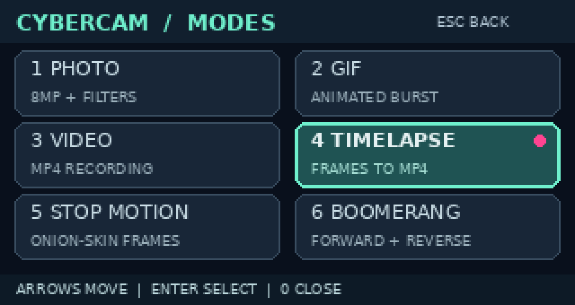
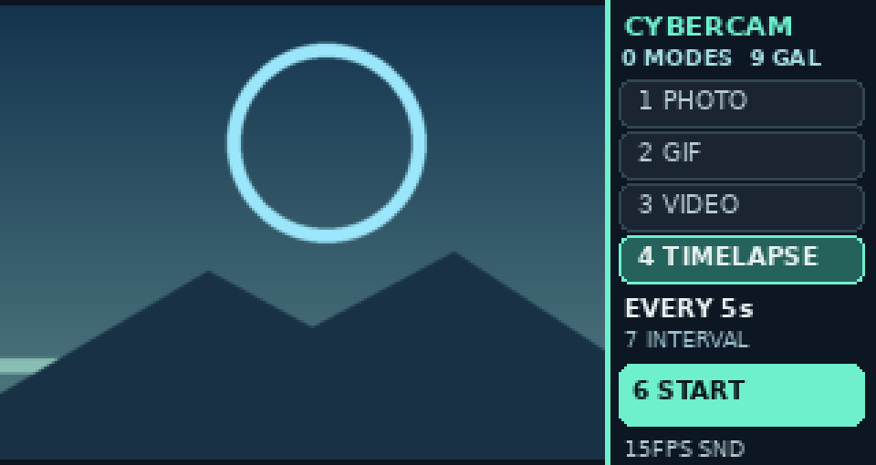

# CyberCam v0.5.2 — by Cybern0mads

**Open-source camera for M5Stack Cardputer Zero · 8MP photo · Retro filters · GIF · MP4 · Timelapse · Stop Motion · Wi-Fi Gallery**





> Screenshots in this repository are simulated UI demonstrations. They are not real camera captures.

CyberCam is a standalone, keyboard-operated camera app for the Raspberry Pi-based **Cardputer Zero** with the IMX219 sensor and 320×170 display. It uses the standard Raspberry Pi `rpicam-*` camera utilities and an RGB565 framebuffer. No other camera application is required.

## What's new in v0.5.2 — intuitive navigation

- Press **`0`** (or `M`) once to open a full-screen, six-tile **Modes menu**. Navigate using arrows and Enter or use the numbered mode keys shown in the menu.
- Press **`4`** directly from the viewfinder to enter **Timelapse**—no more cycling through hidden modes. Timelapse's `7 INTERVAL` and `6 START/STOP` are always labeled.
- Photo (`1`), GIF (`2`), Video (`3`), Gallery (`9`), Capture (`6`), Filter (`5`) and Sound (`8`) remain available from the viewfinder.
- Stop Motion (`5`) and Boomerang (`6`) are selectable **inside the Modes menu only** (those keys retain their previous shooting behavior when the menu is closed).
- Clearer mode highlight, high-contrast large buttons and a lightweight static menu that doesn't need live camera rendering.
- This is a navigation/UI update; original photo, GIF, video, timelapse, gallery, filter and Wi-Fi sharing pipelines are unchanged. Hardware verification is still needed.

## Previously added in v0.5


- **Eight new filters**: `GAMEBOY+`, `VHS1998`, `CYBERVISION`, `FILM1999`, `VIRTUALRED`, `C64RETRO`, `NEONEDGE`, `PIXELDREAM`.
- **Glitch effect**: `CYBERGLITCH` (extra), available for stills, GIFs, Boomerang and timelapse export.
- Existing looks preserved: `NORMAL`, `MONO`, `GBOY`, `GREEN`, `4TONE`, `PIXEL`, `HICON`.
- **Timelapse**: frame intervals 2s, 5s, 10s, 30s, 1m, 5m, 30m; stop and automatically render MP4 with FFmpeg. Original frames are kept. Output is 640×480 (15 FPS) by default for CPU/memory safety. Rendering can take a while on the device.
- **Stop Motion**: manually capture frames with transparent onion-skin guidance from the previous shot; export a GIF and an MP4. Interactive stop-motion frame source is the **320×240 MJPEG preview**, not 8MP, to keep frame alignment responsive.
- **Boomerang**: capture a short live burst and export a forward/backward animated GIF. Choose `CYBERGLITCH` to make a glitch boomerang.
- **Wi-Fi Gallery**: browse/download saved photos, GIFs, videos and generated timelapse/stop-motion MP4s in a browser. The server **is off by default**, has a random per-run access token, and defaults to localhost-only for safety. Opt into a LAN listener explicitly.
- **Performance**: preserve 15 FPS target, keep the lightweight full-FOV camera preview, cache fonts and film vignette, process full-res effects after capture; improve GIF full-FOV letterboxing.
- Same neon cyan/purple Cybern0mads APPLaunch and store icons.

### Existing features retained

- Native, clean original **3280×2464 (8MP)** JPEG photography plus full-dimension retro PNG variants (pixel look is deliberately low-detail).
- Wide full-sensor IMX219 4:3 preview and MP4 recording, shutter sound, 180° image rotation, 15 FPS preview *target*.
- Video presets: **1280×960/30**, **1440×1080/30**, **1280×720/30** (cropped vertically), **640×480/30**. Video is **silent**; no microphone audio is captured.
- `9 GALLERY` on-device image/GIF/MP4 playback; the MP4 decoder uses FFmpeg and may drop frames on Pi Zero-class CPUs.

## Final interface — visible Gallery button

The main 320×170 camera screen now has a **full-width purple `9 GALLERY` button**
under the shooting mode shortcuts, plus the cyan `6 CAPTURE`/`6 RECORD` button.
Gallery is also shown as its own large bottom tile in the `0 ALL MODES` menu,
where arrows + Enter or `9` opens it. Gallery continues to show existing photos,
animated GIFs and silent MP4s; pressing `9` or Esc returns to live camera.
The viewfinder keeps the same width and full-sensor capture pipeline as v0.5.1.
The active look, size or Timelapse interval are shown on the preview itself.

## Handheld controls — v0.5.2

**Recommended workflow:** Choose `1`/`2`/`3`/`4`, press `6` to capture or record, and press the prominently displayed `9 GALLERY` button to review media. Press `0` for every shooting mode plus Gallery. **For Timelapse, simply press `4` from the camera view**, `7` for interval, and `6` to start or stop.

| Key | Camera screen | Modes menu |
|---|---|---|
| `0` / `M` | Open Modes menu | Close Modes menu |
| `1` | Photo mode | Select Photo |
| `2` | GIF mode | Select GIF |
| `3` | Video mode | Select Video |
| `4` | **Timelapse mode** | Select Timelapse |
| `5` / `F` | Change filter | Select Stop Motion |
| `6` / Enter / Space | **Capture / start / stop** | `6` selects Boomerang; Enter selects highlighted mode |
| `7` / `R` | Resolution / video preset; Timelapse interval; Stop Motion export | — |
| `8` / `S` | Toggle shutter sound | — |
| `9` | Open on-device Gallery | Open Gallery |
| Left / Right | Change filter | Move between menu tiles |
| Up / Down | Cycle modes | Move between menu rows |
| Esc | Exit app (if safe) | Return to camera without changing mode |

**Gallery:** `4` / `5` previous/next; `6` fullscreen or play/pause; `9` / Esc return.

**Timelapse:** Press `4`, press `7` to choose the interval (2s, 5s, 10s, 30s, 1m, 5m, 30m). Press `6 START`; then `6 STOP` to stop shooting and export the MP4 automatically. Original frames remain in the session folder. **Keep the Cardputer powered on until export finishes.** The screen may briefly pause during full-resolution still capture.

**Stop Motion:** Press `0`, then `5` (or choose the tile), press `6` for each frame, `7` to export GIF and MP4. Onion skin overlays the prior frame in the camera preview. At least two frames required.

**Boomerang:** Press `0`, then `6` (or choose the tile), use `5` outside the menu to select a filter, and press `6` to record and save a forward/backward GIF. In particular, `CYBERGLITCH` adds digital interference.

## Installation

Download `cybercam_0.5.2_all.deb` from the [`releases/` folder](releases/). From **any computer with SSH installed** (macOS, Linux, or Windows PowerShell/OpenSSH), with the Cardputer on the same network:

```bash
scp ~/Downloads/cybercam_0.5.2_all.deb pi0@CardputerZero.local:/tmp/
ssh pi0@CardputerZero.local
```

Then **on the Cardputer SSH terminal**:

```bash
sudo apt install -y /tmp/cybercam_0.5.2_all.deb
cybercam diagnose
```

**Close any other camera app before opening CyberCam** so the camera is available. Start **APPLaunch → CyberCam**. Your existing CyberCam captures stay in `~/Pictures/CyberCam/`.

## CLI tests

```bash
cybercam photo --filter GAMEBOY+
cybercam gif --filter C64RETRO
cybercam boomerang --filter CYBERGLITCH
cybercam timelapse --interval 5 --frames 6 --fps 15 --filter NEONEDGE --resolution 1640x1232
cybercam video --seconds 5 --video-quality wide
cybercam gallery
```

**CLI Timelapse** has a finite `--frames` count; the UI Timelapse runs until `6 STOP`. The still-photo capture command has camera startup overhead, so a 2-second interval is a *minimum wait after each capture*, not a strict wall-clock 2-second start-to-start cadence.

### Wi-Fi Gallery from any computer (recommended secure method)

On the Cardputer Zero (via SSH):

```bash
cybercam web
```

It will print a random, one-time token. On **any computer with SSH** (macOS Terminal, Linux terminal, or Windows PowerShell/OpenSSH), open a second terminal and keep this SSH tunnel running:

```bash
ssh -L 8765:127.0.0.1:8765 pi0@CardputerZero.local
```

Visit the exact **`http://127.0.0.1:8765/?key=TOKEN`** shown by CyberCam, replacing `TOKEN` with the value printed by the server. After login, the browser uses an HttpOnly session cookie; the server is **local-only** by default. Press Ctrl+C in the server terminal to stop sharing.

For any computer, phone, or tablet on the **same trusted Wi-Fi**, you can instead explicitly run:

```bash
cybercam web --bind 0.0.0.0 --port 8765
```

Then visit `http://CARDPUTER_IP:8765/?key=TOKEN`. This runs over **unencrypted HTTP** on the local network: don't expose/port-forward this endpoint to the internet, and avoid using untrusted Wi-Fi. People with the session link/token can access your CyberCam captures while the server is running. No background server is enabled automatically.

## Media directories

```text
~/Pictures/CyberCam/
  Photos/       # 8MP JPEG + look PNG
  GIFs/         # animated GIF, boomerang, stop-motion
  Videos/       # silent MP4
  Timelapse/    # rendered MP4, plus original JPEG frames in session subfolders
  StopMotion/   # rendered MP4, plus captured JPEG frames in session subfolders
```

The built-in Gallery and web Gallery list rendered outputs, not every source frame from long timelapses. Source frames remain accessible over SSH/SCP.

## Build and test

Dependencies on the target: Python 3, Pillow, evdev, numpy, ALSA (`aplay`), ffmpeg, `rpicam-still`, `rpicam-vid` and an RGB565 framebuffer. `rpicam-*` are supplied by the device firmware, not by this app package.

On Linux/Debian with Pillow and `dpkg-deb`:

```bash
python3 -m unittest discover -s tests -v
python3 packaging/make_package.py
```

The package is architecture-independent (`all`) and installs a Python CLI, a GUI launcher, the shutter sound and the Cybern0mads icon.

## Attribution and limitations

MIT © 2026 **Cybern0mads** — <https://github.com/cybern0mads/CyberCam>

- CyberCam is an independent community project, not an official Cardputer app. References to Game Boy, Commodore 64, and MEMENTO describe visual styles only. All trademarks belong to their respective owners.
- Retro looks are software simulations. `CYBERVISION` is **not actual infrared/thermal imaging**.
- Camera access is exclusive: close another camera program before opening CyberCam. Live preview freezes during photo/timelapse/video operations that own the sensor.
- Full-resolution 8MP image processing and timelapse encoding are CPU-intensive; long runs require power and sufficient SD-card capacity.
- **Hardware verification is still needed** for Timelapse, Stop Motion, Boomerang, Wi-Fi over the device's network and the additional looks. Offline automated tests do not prove 15 FPS performance on the device.
- For AppStore submission use `assets/cybercam_appstore_512.png`, a real Cardputer screenshot and the `cybercam_0.5.2_all.deb` package after on-device checks.
